<h3 align="center"><a href="https://revjmoney.github.io/lfd3k-sm/">&#9654; THE WEBSITE: revjmoney.github.io/lfd3k-sm</a></h3>

<p align="center">
  <a href="https://revjmoney.github.io/lfd3k-sm/">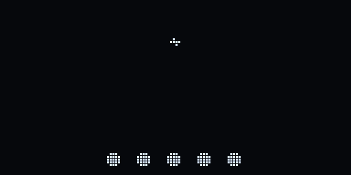</a>
</p>

<h1 align="center">LORA FLOWTRON DATAMASTER 3000 SERIAL MODEM - LFD3K-SM</h1>

<p align="center">
  <br>
  <b>v0.1.0 r.420 BL4Z3B4ND ULTR4M0D3M</b><br>
  <i>S0N1C B00M R4D10 PR0 MAX</i><br>
  by Rev. J. Money / <a href="https://jmscnc.com">jmscnc.com</a><br>
  <b>Website: <a href="https://revjmoney.github.io/lfd3k-sm/">revjmoney.github.io/lfd3k-sm</a></b>
</p>

<p align="center">
  <a href="https://revjmoney.github.io/lfd3k-sm/#call">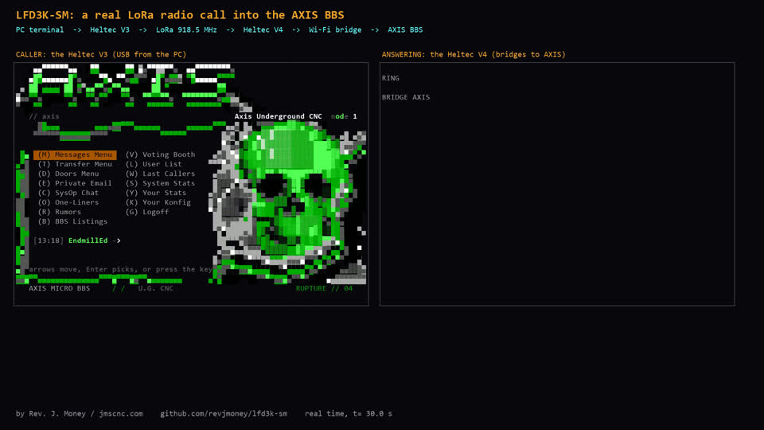</a><br>
  <b>&#9654; <a href="https://revjmoney.github.io/lfd3k-sm/#call">Watch a real call</a></b>: a Heltec V3 dials a Heltec V4 over LoRa on 918.5 MHz,
  the V4 bridges it into the AXIS BBS, and the caller walks around the board (real time, 3 minutes,
  <a href="docs/video/lfd3k-radio-call.mp4">MP4</a>).
</p>

A Hayes-style dial-up modem that talks over **LoRa radio** and **Wi-Fi**, built for the Heltec V4
(ESP32-S3 plus SX1262). Plug it into any terminal program, type `ATDT`, and you get `DIALING`,
`RINGING`, `CONNECT`, retrains and `NO CARRIER`, the way BBS calling used to feel, except the call
goes over the air with no phone line and no internet. It is the radio side of the
[AXIS BBS](https://github.com/revjmoney/axis-bbs) telnet BBS firmware: a caller with a modem can dial a BBS
across town on 918.5 MHz.

## Why it is badass

- **Real modem manners.** `ATD`, `ATA`, `ATH`, `ATO`, `ATI`, `AT&V`, `ATZ`, S registers, `+++` with
  guard time, verbose and numeric result codes, auto-answer. Your old terminal scripts just work.
- **8 speed tiers, picked live.** SF12 to SF5 at 500 kHz (about 1.2 to 62.5 kbps on the air). The
  modems train on the measured SNR, start at the best tier the link can hold, step down when the
  signal fades, and climb back up when it clears. You see it happen: `RETRAIN`.
- **Nothing gets lost.** Selective-repeat ARQ (window 8, SACK bitmap), half-duplex burst manners,
  keepalives, resync to SF12 when the link dies for a moment, `NO CARRIER` only when it is really gone.
- **LZ compression on the air.** Each frame is squeezed against a preset tuned for ANSI art, CP437
  boxes and blocks, so BBS screens fly.
- **Wi-Fi too.** Its own WPA2 hotspot, a client network, up to 8 named forwards
  (`ATDT AXIS` opens a telnet call), and a published forward so radio callers reach a telnet BBS.
- **Find your friends.** Beacons, `AT+SCAN`, a station directory with pinning, dial by name, and a
  privacy mode.
- **A full-screen setup menu.** `AT+MENU` opens an 80x24 ANSI lightbar menu (CP437, 16 colors) for
  SyncTERM: directory and scan, live link status, settings, forwards, Wi-Fi.
- **A front panel with attitude.** The OLED shows modem lights (OH CD SD RD HS EC DC AA), the call
  state, tier, RSSI and SNR, a radar sweep while scanning, and an idle show in 17 languages.
- **Four modes in one radio.** A custom bootloader and picker carry LFD3K-SM, Simian Radar, RNode
  and Meshtastic in their own slots: `AT+MODE=RNODE` and the board comes back up as an RNode.
- **Tested hard.** A `no_std`, no-heap Rust core with a seeded LoRa channel simulator, two-modem call
  scenarios (SNR dips, lost frames, collisions, resyncs) and proptest fuzzing of frames and AT lines.
  The simulator found real bugs before any radio did.

## Animations

| Idle show | Radar scope | Disintegrate | Boot logo |
|---|---|---|---|
| 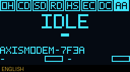 | 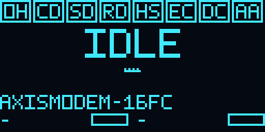 | 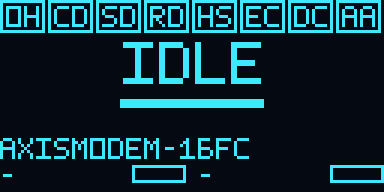 |  |

The full idle loop: 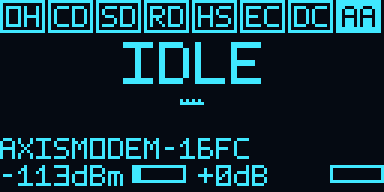

## Screenshots

### The setup menu (`AT+MENU`, best in SyncTERM with the CP437 font)

| | |
|---|---|
| 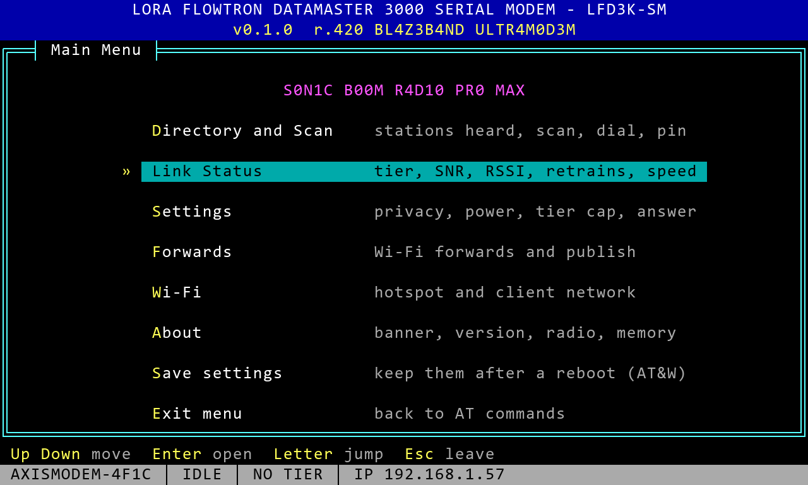<br>Main menu | 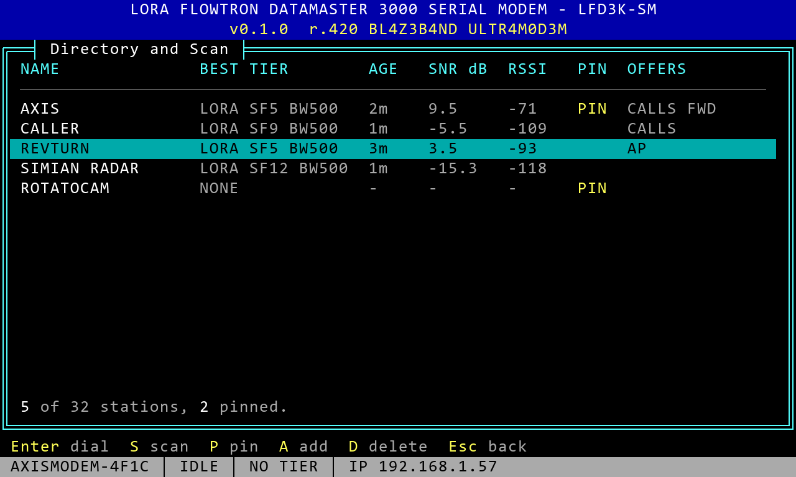<br>Directory |
| 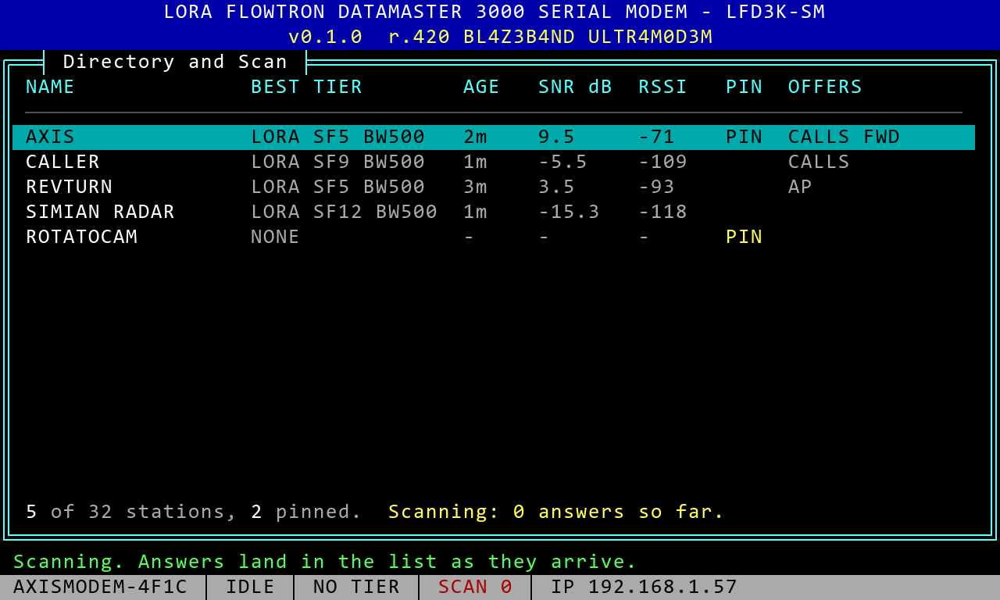<br>Scanning the air | 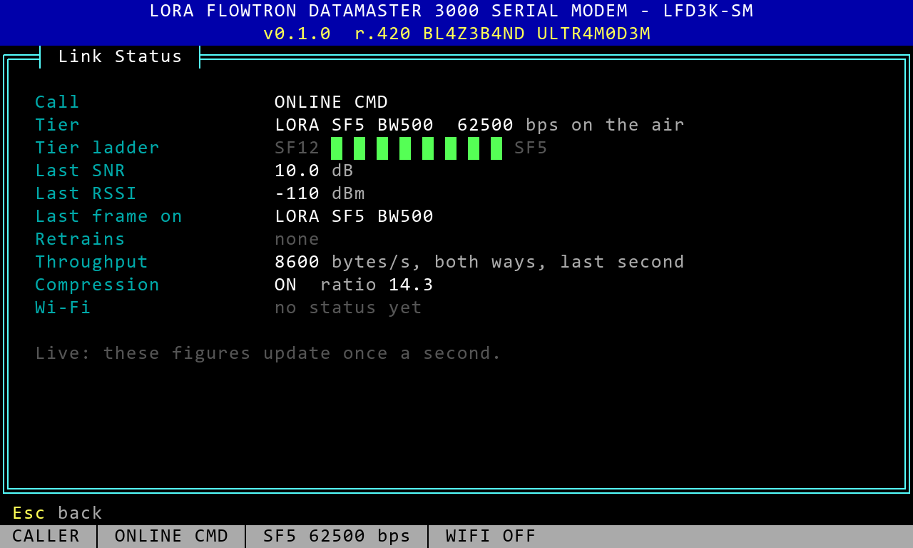<br>Live link status in a call |
| 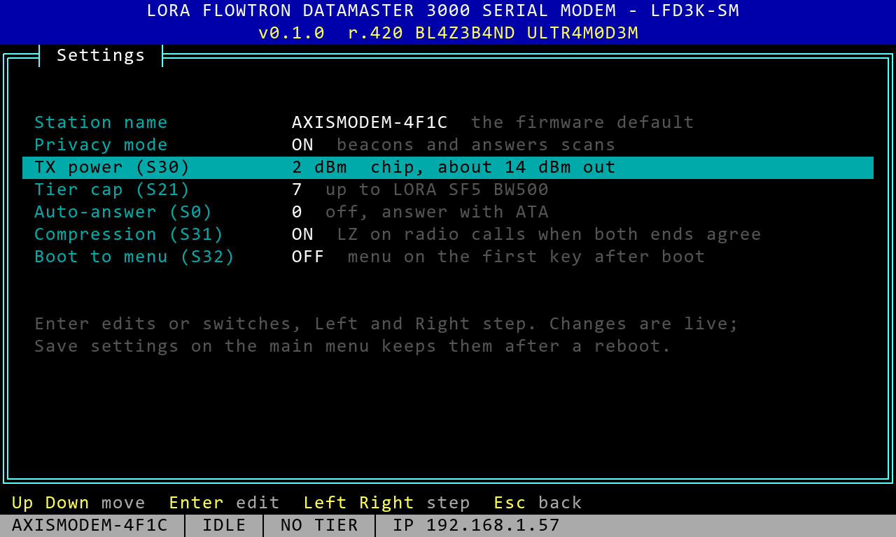<br>Settings | 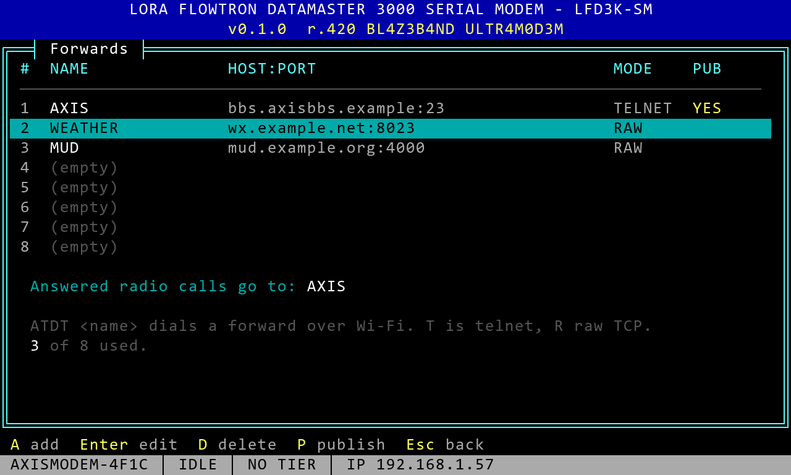<br>Forwards |
| 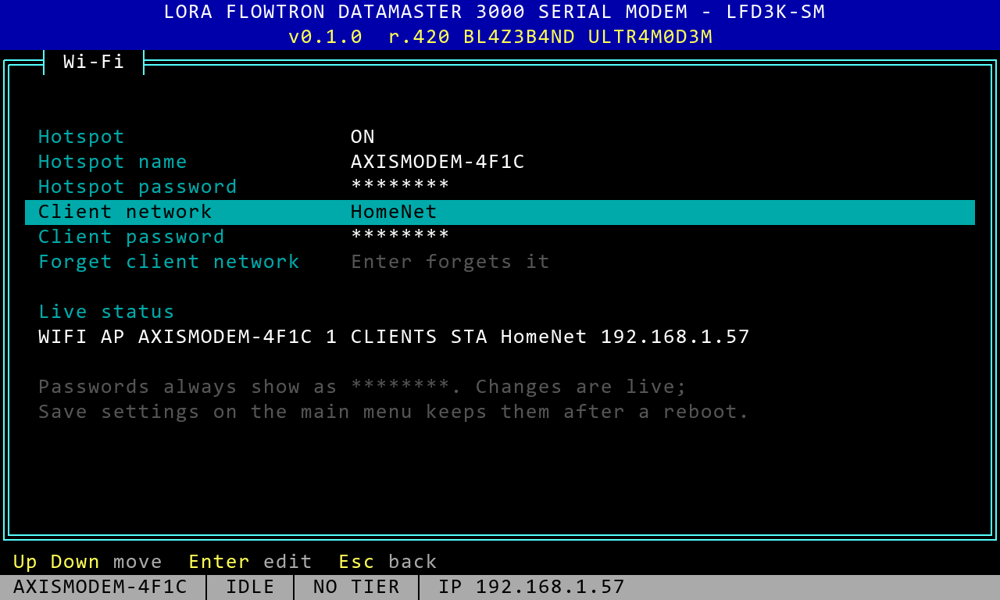<br>Wi-Fi (passwords always hidden) | 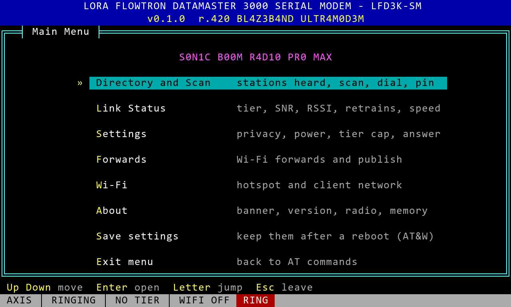<br>RING while you are in the menu |
| 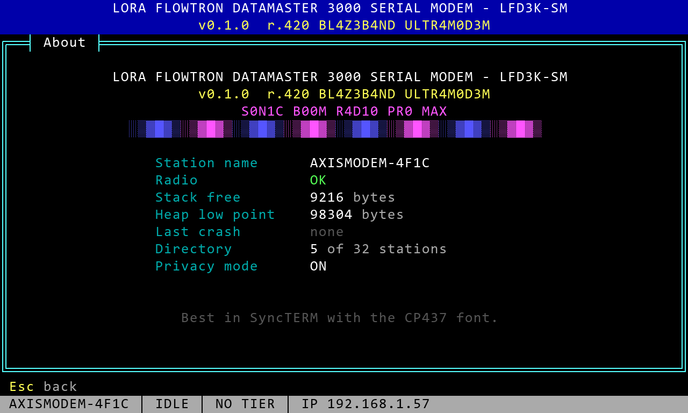<br>About | 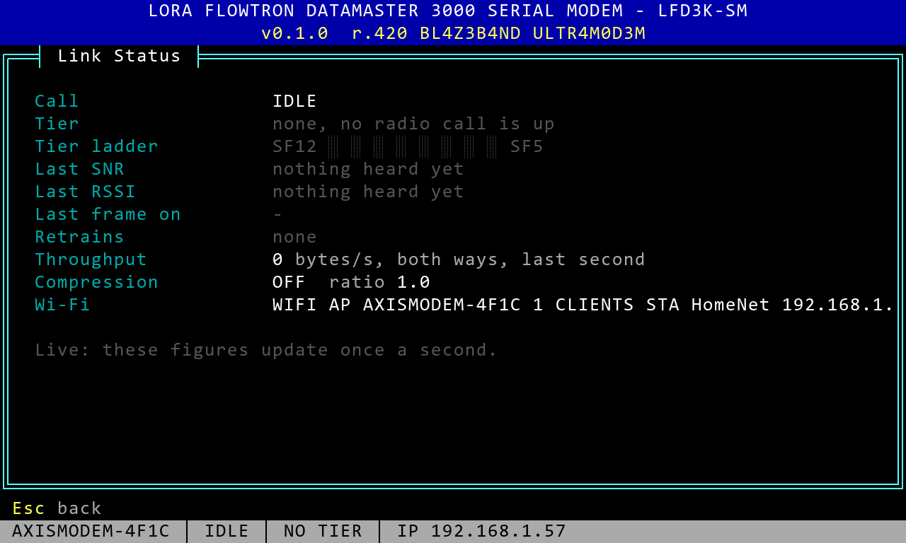<br>Link status, idle |

### The front panel

| | | |
|---|---|---|
| 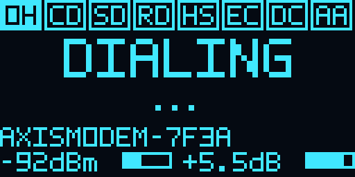<br>Dialing | 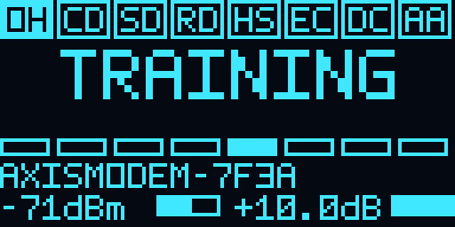<br>Training | 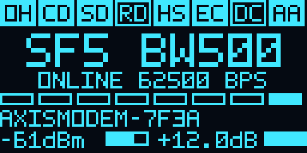<br>Online at SF5 |
| 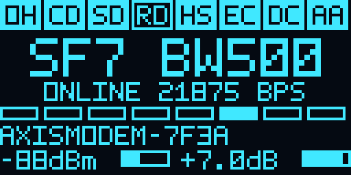<br>Online, compressed | 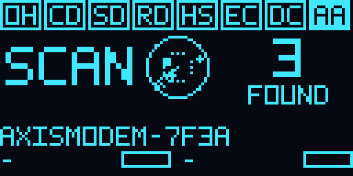<br>Scan radar | 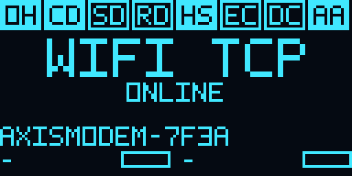<br>Wi-Fi telnet call |
| 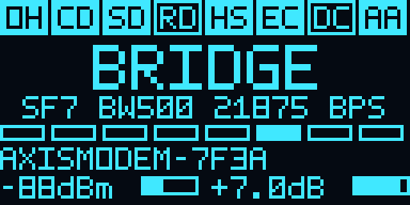<br>Radio to telnet bridge | 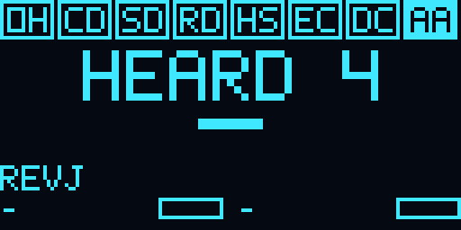<br>Stations heard | 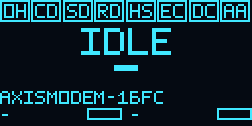<br>The real panel |

### On the air

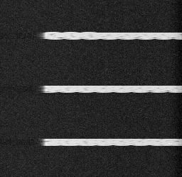<br>
LFD3K-SM bursts on 918.5 MHz, seen on an SDR waterfall.

## Quick start

```text
ATI                      who am I (name, version, release)
AT+MENU                  the full-screen setup menu
AT+SCAN                  look for other modems on the air
ATDT AXISMODEM-1A2B      dial another modem by name over LoRa
ATDT AXIS                dial a saved forward (a telnet BBS) over Wi-Fi
ATDT bbs.example.com:23  dial any telnet host
+++  (wait)  ATH         hang up
AT&V                     show every setting and the link
```

Settings, S registers and every AT command are in [`docs/FEATURES.md`](docs/FEATURES.md).

## Building

| Part | Where | How |
|---|---|---|
| Protocol core (Rust, `no_std`) | `core/` | `cargo test --workspace` |
| PC simulator and demo | `sim/` | `cargo run -p lfd3k-sim -- --snr 10 --seed 420` |
| PC modem (the real core over UDP) | `sim/` | `cargo run -p lfd3k-sim --bin lfd3k-pcmodem -- --peer <V4 ip>` |
| SX1262 driver | `sx1262/` | built into the firmware |
| Firmware (ESP-IDF 5.4 via PlatformIO) | `firmware/` | `firmware\build_core.ps1`, then `pio run -d firmware -e heltec_v4` |
| Firmware for the Heltec V3 (the modem alone) | `firmware/` | `firmware\build_core.ps1`, then `pio run -d firmware -e heltec_v3_single -t upload --upload-port COMn` |
| Multimode bootloader and picker | `multimode/` | see [`multimode/README.md`](multimode/README.md) |

The Rust toolchain for the ESP32-S3 is installed with `espup`. The first firmware build downloads
ESP-IDF and takes a while; later builds take seconds.

## Documentation

- [The website](https://revjmoney.github.io/lfd3k-sm/): screenshots, animations and every doc below, [rendered](https://revjmoney.github.io/lfd3k-sm/docs.html)
- [Design](docs/2026-11-09-lfd3k-sm-design.md): the protocol, tiers, frames, ARQ, training and retrain
- [Features, settings and AT commands](docs/FEATURES.md)
- [Multimode](docs/multimode.md): four firmwares on one radio
- [SimNet](docs/simnet.md): call a real V4 from the PC over Wi-Fi with a simulated radio
- Bench sheets: [phase 2](docs/phase2-bench.md), [phase 3](docs/phase3-bench.md), [phase 4](docs/phase4-bench.md)
- [A full demo call transcript](docs/phase1-demo.txt)

## Hardware

Heltec WiFi LoRa 32 V4 (ESP32-S3R2, 16 MB flash, SX1262 with the GC1109 front end), 918.5 MHz
calling channel, 500 kHz bandwidth. Check the rules for your region before you transmit; the default
TX power (S30) is low on purpose.

The **Heltec WiFi LoRa 32 V3** runs it too, as the modem alone (env `heltec_v3_single`, 8 MB flash),
with the AXIS boot logo at power on. Differences from the V4:

* No front end amplifier: S30 is the power at the antenna (22 dBm at most), and AT&V says so.
* Its USB-C port is a CP2102 bridge, so the modem talks on that COM port at 115200 baud, 8N1, no flow
  control. Open it with DTR and RTS off (opening it with them on resets the board). The ESP32-S3's own
  boot text shows on that port for a moment after every reset, before the modem starts.
* The multimode picker is V4 only.

## License

LFD3K-SM is free software under the **GNU General Public License v3 or later**, with one additional
term under GPLv3 section 7(b): keep the attribution **Rev. J. Money / jmscnc.com**. See
[`LICENSE`](LICENSE) and [`NOTICE.md`](NOTICE.md). Third-party notices: [`THIRD_PARTY.md`](THIRD_PARTY.md).

Copyright (C) 2026 Rev. J. Money / [jmscnc.com](https://jmscnc.com)
